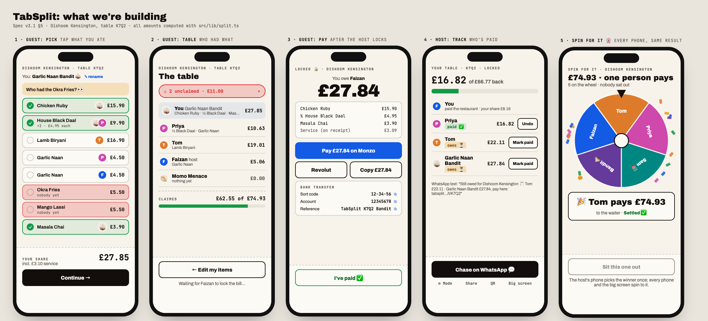
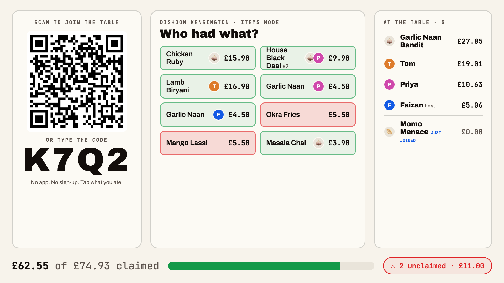

# 🧾 TabSplit, explained

**Read this first.** A 5-minute, plain-English tour of what we're building tonight. Nothing here needs any prep.
The full technical spec is `TABSPLIT_IDEA2.md` if you want the detail, but you don't need it.

---

## The idea in one sentence

**At a group dinner, TabSplit splits the bill item by item on everyone's phone, and makes sure the person who paid
gets their money back before anyone leaves.**

Our tagline: ***"Split the bill. Get paid before anyone stands up."***

---

## The problem

You've been here:

1. Six friends at a restaurant. The bill arrives. Everyone goes quiet.
2. Someone says "let's just split it evenly", and the person who only had a lassi is quietly annoyed.
3. Or one person puts their card down, says "just send me what you owe", then spends **a week chasing people on
   WhatsApp** for £23.51.

Splitting the maths is annoying. **Getting paid back is the real pain.**

---

## How it works (the 60-second version)

Picture a real dinner at Dishoom. The bill is **£74.93**. Faizan pays it.

| Step | What happens | Who |
|---|---|---|
| 1 | Faizan takes a photo of the receipt. **AI reads it** and turns it into a list of dishes with prices. He checks the list and fixes anything wrong. | Host |
| 2 | He types in how he wants to be paid back: Monzo username, Revolut tag and/or bank details. Done once. | Host |
| 3 | He drops a link in the group chat, or everyone types a **4-letter code** like **K7Q2** (like Kahoot). | Host |
| 4 | Everyone opens it. **No app, no sign-up, not even typing a name.** You get a silly name like *"Garlic Naan Bandit 🧄"* (you can rename it). | Guests |
| 5 | You **tap what you ate**. Shared the daal? Two people tap it and it splits in half automatically. Service charge is shared fairly too, to the penny. | Guests |
| 6 | Tap **Continue** to see the whole table: who had what, and a red pill at the top: *"2 unclaimed · £11.00"*. Everyone can see what's left, so nobody can dodge. | Guests |
| 7 | When everything is claimed, Faizan taps **Lock bill**. The numbers freeze. | Host |
| 8 | Every phone now says ***"You owe Faizan £27.84"*** with a **Pay on Monzo** button that has the amount already filled in (plus Revolut and bank details). | Guests |
| 9 | You pay, then tap **"I've paid ✅"**. Faizan watches the ticks come in on his phone. | Both |
| 10 | Someone hasn't paid? Faizan taps **Chase on WhatsApp**, which writes the reminder for him. When everyone has paid: **Settled ✅** and confetti on every phone. | Host |

**The link is the whole app.** The same link is for joining, claiming, paying, and paying later at home.
Your phone remembers who you are.

---

## The three ways to split

The host picks one:

1. **Split by items** (the default). Everyone pays for what they ate, as above.
2. **Split evenly.** Everyone pays the same share of the whole bill, penny-exact (e.g. £74.93 ÷ 3 = £24.98, £24.98, £24.97).
3. **Spin for it 🎡** (the fun one). Like "card roulette": the whole table goes on a wheel, it spins
   **on every phone at the same moment**, and **one person pays the whole bill**.
   - Everyone is on the wheel by default, but there's a big **"Sit this one out"** button, so nobody is forced in.
   - The result is picked once and saved, so every phone lands on the same person. Nobody can argue "mine said Tom".

---

## The screens

These are the screens in the picture at the top (the amounts are real outputs of our maths code):

| Screen | Who sees it | What it's for |
|---|---|---|
| **Pick** | Guests | Tap the dishes you ate. Your running total is at the bottom. |
| **Table** | Guests | Everyone's items and totals, plus the "unclaimed" pill. |
| **Pay** | Guests, after the host locks | "You owe Faizan £27.84" + pay buttons + "I've paid". |
| **Track** | Host, after lock | Who's paid ✅ and who still owes ⏳. Mark cash payments, chase on WhatsApp. |
| **Wheel** | Everyone | The spin, then "🎉 Tom pays £74.93". |
| **Big screen** | The projector (for the pitch) | A giant QR code + code so the judges can join, and the table filling up live. |

---

## Small details that matter

- **Someone's phone died?** The host can add "Sam 🪫" by hand. Sam counts in *Split evenly* and *the wheel*.
  In *split by items*, a friend taps Sam's food as their own and Sam pays them back.
- **Joined late, on a new phone?** After the bill is locked you get "Who are you?", which only lists people who
  haven't paid yet (so you can't take someone else's place), plus "Just watching 👀".
- **Money is never guessed.** Everything is in whole pennies, and the shares always add up exactly to the
  receipt total.
- **Bank details only appear after the host locks the bill**, and only the payment methods the host filled in are shown.
- **Tables delete themselves**: 7 days after everyone's paid, or 30 days if they never settle.

---

## How do we know someone actually paid?

Honestly: **we don't, yet.** The guest taps "I've paid", and the host is the referee (they can undo a tick, or mark
someone as paid in cash). We can't see anyone's bank account. Automatic confirmation through Open Banking is the
"next step" in the pitch.

---

## Why would anyone use this instead of Splitwise?

Splitwise launched receipt splitting in the UK two weeks ago (14 Oct 2026), so the problem is clearly real.
Our angle:

- **Splitwise ends with an IOU** on a running balance you sort out later. **TabSplit ends with the host paid**,
  at the table, tonight.
- **No app for anyone.** Not even the host.
- **UK bank buttons with the amount filled in**, and a live "who's paid" view.
- **The wheel.** Nobody else has it, and it's the bit people will film and share.

**How it could make money (the honest version):** today guests pay the host. Later, guests could pay the
**restaurant directly by bank** from the same screen, which is cheaper for the restaurant than card fees, and we'd
take a cut of the saving. That needs a licensed payment partner, so it's a "where this goes" story, not something
we build tonight.

---

## What we are building tonight (18:00–22:00)

In this order. Each step is a complete, working app on its own, so if we run out of time we still have something
to show:

1. **The core:** create a table, join by link/code/QR, tap your items, live updates on every phone, lock, pay
   buttons, "I've paid", host tracking, Settled. **Must have.**
2. **Receipt photos:** AI reads the receipt (up to 4 photos for a long one). If it's not working by 19:35 we skip
   it and use "type it in" / a demo receipt.
3. **The modes:** split evenly, the wheel, adding a person without a phone.
4. **Polish:** confetti, the WhatsApp chase button, a "simulate a table" button for the demo.

🔒 **Feature freeze at 20:45.** After that we only test and rehearse.

**Not building tonight:** accounts or logins, real payment processing, running balances between friends, other
currencies, a phone app (it's a website), push notifications.

---

## The 2-minute pitch (draft)

1. **Hook:** "Hands up if you've been at a group dinner where the bill arrived and everyone went quiet."
2. **Join + claim:** hold up a real receipt, AI reads it, and **the judges scan the big screen** and tap what they
   "ate". Their silly names pop up live.
3. **The money:** point at the red pill ("who had the garlic naan? 👀"), lock, a phone shows "You owe Faizan £X"
   with the Monzo button, a teammate pays, a ✅ appears.
4. **The wheel (maybe):** switch to Spin for it, every phone in the room spins at once, one person "pays".
5. **Close:** "Splitwise ends with an IOU. TabSplit ends with the host paid before the waiter's back."

We decide the ending (wheel or confetti) at 21:15, once we've seen it all working.

---

## Honest weak spots (please poke at these)

- **The 4-character code can be guessed.** Someone who guesses a live code could see that table, including the
  host's bank details through the API. Fine for a hackathon; the real fix is longer private links and pay-by-bank
  links instead of raw bank details.
- **"I've paid" is the honour system.**
- **Splitwise got there first** with receipt splitting.
- **The business model is a bet**, not proven.
- **The AI can misread a receipt.** The host always checks the list first, and the app compares it to the printed total.

---

## How you can help tonight

Only one person can type prompts into Lovable (it's one shared team account), so **your job is to test, break
things, and give ideas.** That's genuinely the most useful thing.

### 🧪 Testing (when Faizan says a version is ready)
Bring a **charged phone**. Ideally we have both **iPhone and Android**, and someone with **Monzo** and someone with
**Revolut**.

- [ ] Join by **scanning the QR**, by **typing the code**, and by **opening the link** from WhatsApp.
- [ ] Tap items, untap them, share one item with someone else. Do the totals look right?
- [ ] Do other people's taps show up on your phone within a second or two?
- [ ] Rename yourself. Try an emoji, a very long name, an empty name.
- [ ] Is anything covered by the "Edit with Lovable" badge at the bottom of the screen?
- [ ] After the host locks: does **Pay on Monzo** open Monzo with the right amount? What happens on a phone
      **without** Monzo? What does the Revolut button do?
- [ ] Turn Wi-Fi off and use 4G. Lock your phone for a minute and come back. Does it catch up?
- [ ] **Try to break it:** two people tap the same thing at the same time, tap like mad, tap right as the host
      locks, open the link on two phones at once.
- [ ] Write down anything confusing, ugly or broken (a screenshot is perfect) and send it to Faizan.

### 💡 Ideas we want your opinion on
1. Would **you** actually use this at a real dinner? What would stop you?
2. Is **the wheel** fun, or awkward/risky (does it feel like gambling)?
3. Is **"TabSplit"** a good name? Better ideas?
4. What's the one thing a judge will ask that we can't answer?
5. Which ending is better for the pitch: **the wheel** or **everyone-paid confetti**?
6. Anything missing that every real dinner needs (e.g. someone paying cash, a discount, tips)?

---

## Words you might hear tonight

- **Host:** the person who paid the restaurant and is owed money.
- **Guest:** everyone else at the table.
- **Claim:** tapping a dish to say "I had this".
- **Lock:** the host freezing the bill so the amounts stop changing and people can pay.
- **Settled:** everyone has paid the host. 🎉
- **Lovable:** the AI website builder we're using. We describe what we want and it writes the code.
- **Argon:** the second AI (Gemini) we use to criticise our plans and find bugs.
