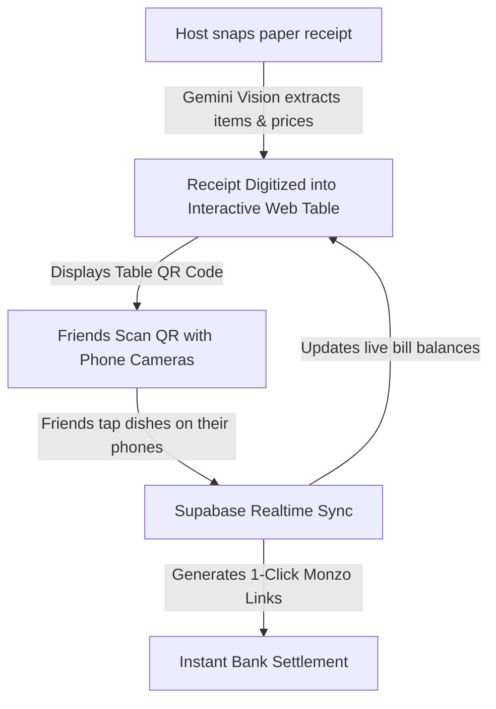

# 🧾 Idea 2: TabSplit
**Theme:** The Zero-Math, Real-Time Group Restaurant Bill & Receipt Arbiter  
**Role in Hackathon:** The Ironclad Backup (0% Venture Jargon, 100% Relatable, Bulletproof Demo)  
**Time Limit:** 4 Hours (18:00 – 22:00) | **Target Event:** Imperial Entrepreneurs x YFL

---

## 📌 1. The General Idea (In One Short Paragraph)
TabSplit is a zero-app, instant web receipt splitter that ends the awkward 20-minute arithmetic struggle at group dinners. When a group of friends receives a paper restaurant bill, one person snaps a photo; Gemini Vision digitizes the itemized dishes in 3 seconds and generates a table QR code. Everyone at the table scans the code on their own phone, taps the dishes and drinks they had, and watches the bill balance update live in real time. TabSplit automatically calculates each person’s fair share of London's 12.5% service charge and generates 1-click Monzo and Revolut settlement links so the entire table pays up in 10 seconds flat.

---

## 🔍 2. Deep Competitor Research & The "10x Wedge"

### Who Exists in This Space? (Market Landscape)
We analyzed the 4 primary categories of bill-splitting apps:

1. **The Giant: Splitwise (and "Plates by Splitwise")**
   * *What they do:* The industry standard for shared flat expenses and recurring holiday ledgers.
   * *What they do better than us:* Multi-currency tracking, recurring monthly balances, and massive 50M+ global user base.
   * *Where they FAIL:* **Awful for live group dining.** Splitwise requires every person at the table to have an account, friend each other, and manually log expenses. Their receipt scanning ("Itemize") is buried behind paid *Splitwise Pro* subscriptions. Nobody wants to sign up for an account while waiting for the card machine.
2. **Dedicated Receipt Apps (e.g., Tab / tabapp.co, Splitty, SplitMyExpenses)**
   * *What they do:* Take a photo of a receipt, OCR extracts items, users tap what they had.
   * *What they do better than us:* Polished native mobile animations and receipt history.
   * *Where they FAIL:* **The App Store Barrier.** They require every dinner guest to download a native iOS/Android app from the App Store and register before they can tap an item. If 2 friends don't have storage on their phones or don't want to download an app, the whole system breaks down, and groups revert to mental math.
3. **Banking Split Features (e.g., Monzo Shared Tabs, Revolut Split Bill)**
   * *What they do:* Let users select transactions from their bank feed and request money from friends via a link.
   * *What they do better than us:* Direct bank-to-bank settlement with zero transfer fees.
   * *Where they FAIL:* **They only do dumb equal splits (50/50).** If 6 friends eat out, but one person only had tap water and a side salad (£9) while another had a ribeye steak and three cocktails (£55), Monzo forces an equal split (£32 each). This creates immense social awkwardness. Monzo cannot read a paper receipt line by line.
4. **Restaurant POS Systems (e.g., Sunday, me&u, Mr Yum)**
   * *What they do:* Integrated QR codes stuck on restaurant tables connected directly to the restaurant's till.
   * *What they do better than us:* Directly prints kitchen tickets and pays the restaurant directly.
   * *Where they FAIL:* **Only works in the 1% of restaurants that buy their expensive hardware.** 99% of London restaurants (from Dishoom and Nando's to local pubs) still hand you a paper receipt on a little silver tray. Sunday is useless if the venue hasn't partnered with them.

### ⚡ TabSplit's Unfair Advantage (Our 10x Wedge)
1. **Zero App Store Downloads (100% Web):** Built on responsive web. Host snaps the receipt, friends scan the QR code with their native camera app, and land directly in Mobile Safari in 2 seconds. No login, no downloads.
2. **Multiplayer Live Claiming (Supabase Realtime):** Just like a Google Doc or Kahoot, when Sarah taps "Halloumi Fries" on her phone, it turns green and locks on everyone else’s screen in real time. If an item is unclaimed, it pulses red (*"Who had the Garlic Bread? 👀"*).
3. **Smart London Service Charge Engine:** Automatically calculates exact proportional 12.5% discretionary service charge and VAT. The person who ordered £10 pays 12.5% of £10 (£1.25); the person who ordered £40 pays 12.5% of £40 (£5.00).
4. **1-Click Monzo / Revolut Deep Links:** TabSplit creates custom deep-links (`monzo.me/faizan/14.50`) so friends tap one button, FaceID confirms, and the host gets paid before standing up from the table.

---

## 🛠️ 3. Full Product Architecture & Workflow

### The Live Dinner Loop:


### The 2 Screens:
1. **The Host / Big Screen View (`/bill/:billId`):**
   * High-contrast receipt breakdown showing all line items.
   * Real-time claim status: Each item shows badges with the initials of who claimed it (or "Split between 3 people").
   * Floating Table Summary: Subtotal, 12.5% Service Charge, and Total Settled progress bar (`£142.50 of £180.00 Claimed`).
   * Large Table QR Code in the corner.
2. **The Guest Phone View (`/claim/:billId`):**
   * Clean, thumb-friendly list of menu items with prices.
   * 1-Tap Claiming: Tapping an item marks it as yours. Long-pressing splits it across the table.
   * Bottom Sticky Footer: Shows your exact running total (`Your Share: £16.88 incl. tip`) with a giant **"Pay via Monzo"** button.

### Supabase Database Schema (Built in 15 Minutes):
```sql
-- 1. Bills Table
create table bills (
  id uuid primary key default gen_random_uuid(),
  restaurant_name text not null,
  tax_service_rate numeric default 0.125, -- 12.5% London service charge
  host_monzo_username text, -- e.g. 'faizanarif'
  created_at timestamp with time zone default timezone('utc'::text, now())
);

-- 2. Items Table
create table items (
  id uuid primary key default gen_random_uuid(),
  bill_id uuid references bills(id) on delete cascade,
  name text not null,
  price numeric not null,
  quantity int default 1
);

-- 3. Claims Table (Realtime Enabled)
create table claims (
  id uuid primary key default gen_random_uuid(),
  item_id uuid references items(id) on delete cascade,
  guest_name text not null,
  created_at timestamp with time zone default timezone('utc'::text, now())
);
alter publication supabase_realtime add table claims;
```

---

## ⏱️ 4. The 4-Hour Lovable Build Plan (18:00 – 22:00)

* **18:00 – 18:30 (Data & Seed):** Create Lovable project, set up the 3 Supabase tables. Hardcode a pre-parsed sample Dishoom receipt (8 items, total £148.50) so you never depend on live OCR failing during the demo.
* **18:30 – 19:30 (Guest Claiming Interface):** Build `/claim/:billId`. Big touchable cards for each food item. Tapping an item triggers an immediate optimistic update and inserts a row into `claims`.
* **19:30 – 20:30 (Host Receipt Dashboard & Realtime):** Build `/bill/:billId`. Embed the table QR code. Add Supabase Realtime subscription so that when claims are inserted from guest phones, the item badge turns green and the subtotal recalculates instantly.
* **20:30 – 21:15 (Service Charge & Monzo Link Engine):** Add math helper: `(Item Total) * 1.125`. Generate the 1-click link `https://monzo.me/[username]/[amount]`.
* **21:15 – 22:00 (Failsafe & Polish):** Test with 2 phones simultaneously. Add a comedy banner: if an item is unclaimed, flash a yellow badge: *"Unclaimed: 1x Garlic Naan (£3.50) — Who ordered this?"* Practice the 2-minute pitch.

---

## 🎪 5. The Live Demo & Stage Script (Word-for-Word)

### Time: 2 Minutes Flat (Zero Jargon)

**[0:00 – 0:30] The Hook (Every Single Person Laughs in Recognition):**
> *"Good evening everyone. Quick question: hands up if you've ever been to a group dinner in London—Dishoom, Nando's, birthday drinks—and when the bill arrives, 8 people freeze?"*  
> *(Wait 2 seconds, almost every hand in the room will go up).*  
> *"For the next 20 minutes, people stare at a greasy paper receipt with their iPhone calculators out. Someone says 'I didn't have any wine', someone forgets the 12.5% service charge, and at the end of the night, one unlucky person has to put down their card and ends up £40 short on Monzo."*

**[0:30 – 1:15] The Live Demo (Audience Becomes the Dinner Party):**
> *"We built **TabSplit** to kill the group bill nightmare forever.*  
> *(Show the big screen with an itemized Dishoom bill).*  
> *Tonight, we went out for dinner. Here is our bill: Chicken Ruby, Biryani, Black Daal, Naan bread. Pull out your phones and scan the table QR code right now.*  
> *(Pause for 5 seconds as judges scan).*  
> *Tap what you ate."*

**[1:15 – 1:45] The Realtime Magic:**
> *(Watch items turn green on the projector as judges tap on their phones).*  
> *"Look at the screen: Judge 1 just claimed the Chicken Ruby. Judge 2 claimed the Biryani and shared the Naan. Notice how the app automatically calculated everyone's exact 12.5% service charge down to the penny.*  
> *(Point to an unclaimed item)*: *And look at that flashing red warning: 'Unclaimed: Garlic Naan'—because there's always one person who forgets their side dish!"*

**[1:45 – 2:00] The 1-Click Pay & Close:**
> *"Now look at your phones: there's a big green button that says 'Pay via Monzo'. Tap it, FaceID confirms, and the host is fully paid before the waiter even brings the card machine. No app download. No accounts. TabSplit makes group dining painless. Thank you."*

---

## ❓ 6. Bulletproof Q&A Defense for Judges

* **Judge Q: "Doesn't Splitwise already do this?"**  
  * *Your Answer:* "Splitwise is great for roommates tracking rent over six months, but it's terrible at a restaurant table. Splitwise forces all 8 people to download an app, create an account, and friend each other. TabSplit requires zero downloads—you scan a QR code with your camera and claim your food in a web browser in 5 seconds."
* **Judge Q: "How do you make money from this?"**  
  * *Your Answer:* "Two clear revenue streams: First, affiliate kickbacks and referral fees from neobanks (Monzo/Revolut) for driving direct P2P payments. Second, B2B restaurant marketing: when users settle their bill on TabSplit, restaurants can offer an instant 10% loyalty reward on their next booking."
* **Judge Q: "What if someone claims someone else's food by mistake?"**  
  * *Your Answer:* "The UI is optimistic and collaborative: tapping an item claims it, but any item can be tapped again to unclaim or mark as 'Shared (split 2 ways)'. Because the host screen is visible to the table in real time, social accountability prevents errors."
